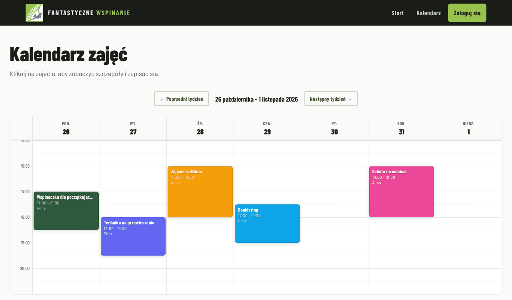
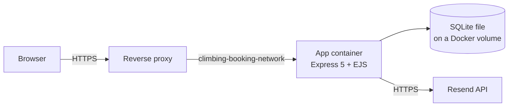

# climbing-booking

[](https://github.com/prod-explore/climbing-booking/actions/workflows/ci.yml)

Class sign-up for a climbing school. Participants see a weekly schedule, book themselves and up to four other people,
and join a waiting list when a class is full; the first person on the list is booked automatically when a place frees
up. Family classes keep separate places for adults and children. Login is by a one-time link sent by e-mail, so
there are no passwords. Instructors see the participant lists of their own classes; an administrator runs the schedule.

One Node.js process (Express 5, server-rendered EJS) with a SQLite database, shipped as a Docker image for amd64 and
arm64. The interface and the e-mails are in Polish.

[[Q1: Does it run in production for a real school? Since when, and with how many accounts or bookings? May the README name the school and link the live site?]]
[[Q2: In one sentence, who was it built for and what did it replace?]]



*The public calendar, filled with the sample data from `npm run seed`.*

## Try it locally

Needs Node.js 22 or newer and a POSIX shell (on Windows: Git Bash or WSL).

```sh
git clone https://github.com/prod-explore/climbing-booking.git
cd climbing-booking
npm ci
cp .env.example .env
echo "JWT_SECRET=$(openssl rand -hex 32)" >> .env
npm run seed
npm start
```

`npm run seed` adds five sample classes for next week, three instructors, three bookings and sample venue details to
an empty local database (`data/climbing-booking.db`). It refuses to run on a database that already has classes, or
with `NODE_ENV=production`. Then:

- Open <http://localhost:3000/calendar?week=1> to see the week above.
- Sign in at <http://localhost:3000/login> with any address. Without `RESEND_API_KEY` the e-mail is not sent: the
  server prints it, login link included, to the terminal. Open the link and confirm.
- The administrator is `admin@example.com` (from `ADMIN_EMAILS` in `.env`); sign in at
  <http://localhost:3000/admin/login>.
- `anna.instruktor@example.com` is one of the sample instructors; after signing in, open
  <http://localhost:3000/instructor>.

`.env.example` documents every variable. If you change `PORT`, change `APP_URL` too: the links in the e-mails are
built from it.

## What it does

| Who | What they can do |
| --- | --- |
| Visitor | See this week's classes on the home page and the coming weeks in the calendar, with the free places of each pool. |
| Participant | Sign in by e-mail link, complete a profile once, book themselves plus up to four people, cancel a whole booking or one person, join and leave a waiting list. |
| Instructor | See the classes linked to their account and the participant lists of those classes. Read-only. |
| Administrator | Create, edit, cancel, archive and restore classes; copy this week's classes forward; see attendance and waiting lists; remove a participant (the person who booked gets an e-mail); approve parental consent for 16- and 17-year-olds; add and remove instructors; set the operator and venue details shown on the public pages. |

The rules behind this (age limits, the two pools, when cancelling is allowed, how the waiting list moves) are in
[docs/booking-rules.md](docs/booking-rules.md).

## How it works



- **Server-rendered pages, no front-end build.** Every page is an EJS template. Client-side JavaScript (two files in
  `public/js/` and inline blocks in some views) only adds modals, tabs and notices. Forms post to the server, which
  redirects with the outcome.
- **One SQLite file, opened synchronously.** `better-sqlite3` in WAL mode, foreign keys on. Numbered SQL files in
  `src/migrations/` are applied at start-up, each in its own transaction; a file that fails is rolled back, left
  unrecorded, and stops the start-up with its error.
- **Administrators in the environment, everything else in the database.** The administrators are the addresses in
  `ADMIN_EMAILS`. Instructors are accounts with the instructor role, added and removed at `/admin/instructors`. Who the
  data controller is and where the classes take place are edited at `/admin/settings`; until then the public pages
  show visible placeholders.
- **No job queue.** A timer in the process archives the classes of past weeks once a day (and at every start).
  Waiting-list promotion runs in the request that freed the place; its e-mail is not awaited, and a failure is
  logged without reaching the user who cancelled.

### Decisions and their trade-offs

**The capacity check and the insert share one write transaction.** `BookingModel.book` opens the transaction with
`BEGIN IMMEDIATE`, which takes SQLite's write lock before it counts the free places, then inserts the booking and its
participants. Two people booking the last place at the same moment cannot both get it, also when one of them is the
waiting list promoting someone. The route's own checks before that only produce clearer error messages. The price is
SQLite's single writer.

**A login link shows a button; it does not sign you in.** Mail scanners and link previews open the links in a
message. If `GET /auth/verify` used the token, a scanner would spend it before the person clicks. The GET page only
asks for confirmation; `POST /auth/verify` checks and spends the token in one transaction. Tokens are 32 random bytes,
valid for 15 minutes, single use.

**Sessions are a signed cookie, not server-side state.** The cookie holds an HS256 JWT valid for 90 days and no role.
Every request loads the account from the database and takes the administrator role from `ADMIN_EMAILS`, so a changed
role or profile applies at once, also in an open session. A session itself cannot be ended from the server before it
expires (see [Known limitations](#known-limitations)).

**Instructors are linked to classes by account id, not by name.** Migration 008 replaced a name match in which
"Jan" also saw "Janina"'s participants. It links existing classes only where exactly one instructor account matches
and leaves the rest for an administrator to assign.

**One container, one database, one process.** No external database or cache to run. In exchange, the rate limits
live in memory and the app cannot be scaled to more than one instance on the same data.

### Security model

| Concern | What the code does | Where |
| --- | --- | --- |
| Stolen or replayed login link | Random 256-bit token, 15 minutes, spent atomically on the POST; the confirmation page is `no-store`; the access log prints `token=[redacted]`. | `src/middleware/auth.js`, `src/models/magicToken.js`, `src/utils/redactUrl.js` |
| Forged session | JWT verified with HS256 only. The app refuses to start with the placeholder from `.env.example`, a secret shorter than 32 characters or one with few distinct characters. | `src/middleware/auth.js`, `src/utils/secrets.js` |
| Cross-site requests | Session cookie is `HttpOnly`, `SameSite=Lax` and `Secure` in production. Every POST, PUT, PATCH and DELETE that carries an `Origin` or `Referer` must name this host. | `src/middleware/sameOrigin.js` |
| Open redirect after login | `next` must be a local path; `//host`, `/\host` and control characters are refused. | `src/utils/safeNext.js` |
| Inbox flooding and enumeration | Login links are limited per IP (5 an hour by default) and per address (3 an hour); a hidden honeypot field drops bots. The admin login answers the same for every address and sends a link only to `ADMIN_EMAILS`. | `src/middleware/security.js`, `src/routes/auth.routes.js`, `src/routes/admin.routes.js` |
| Script injection | EJS escapes output; data embedded in `<script>` goes through `safeJson`; HTML tags are stripped from form input; helmet sets a CSP. | `views/`, `src/utils/safeJson.js`, `src/middleware/security.js` |
| Participant data | An instructor sees a participant list only for classes linked to their account. Visits from the leaflet QR code store an HMAC of the IP address, never the address. | `src/routes/instructor.routes.js`, `src/utils/ipHash.js` |
| Error details | In production the error page says only that something failed. | `src/app.js` |
| Container | Runs as the unprivileged `node` user, publishes no host port, has memory and CPU limits. | `Dockerfile`, `docker-compose.yml` |

Third parties: every page loads Google Fonts; the home page embeds a Google Maps frame once a venue address is set.
To report a vulnerability, see [SECURITY.md](SECURITY.md).

## Deployment

CI builds the image natively for `linux/amd64` and `linux/arm64` and publishes it as
`ghcr.io/prod-explore/climbing-booking` (`latest` from `main`, plus a `sha-<commit>` tag for every published build).
[[Q3: Is the GHCR package public, so that anyone can pull it without logging in?]] On the server, the repository
provides `docker-compose.yml` and `scripts/deploy.sh`:

```sh
cp .env.example .env    # production values: APP_URL, JWT_SECRET, RESEND_API_KEY, EMAIL_FROM, ADMIN_EMAILS
scripts/deploy.sh               # pull `latest`, start it, wait for the health check
scripts/deploy.sh sha-1a2b3c4   # deploy, or go back to, a given build
```

`deploy.sh` waits up to 90 seconds for the container to report healthy (`GET /healthz` runs `SELECT 1` on the
database) and restarts the previous image when the new one does not get there.

The container publishes no port. A reverse proxy that terminates TLS joins the `climbing-booking-network` Docker
network and forwards to `climbing-booking-app:3000`. It must pass the browser's `Host` header through, or the
same-origin check refuses every form. The configuration reference, the proxy settings, backups and the first-run
steps are in [docs/deployment.md](docs/deployment.md).

## Known limitations

- **`'unsafe-inline'` scripts in the CSP.** Several views still contain inline `<script>` blocks, so the policy
  cannot forbid inline scripts. Output escaping and input tag stripping are the defence against injected script.
- **Sessions cannot be revoked before they expire.** Signing out clears the cookie in that browser only. The one way
  to end every session at once is a new `JWT_SECRET`, which signs everybody out.
- **In-memory rate limits.** The counters reset when the process restarts and are not shared between processes,
  which is one reason the app runs as a single instance.
- **One instance on one SQLite file.** There is no replication and no built-in backup;
  [docs/deployment.md](docs/deployment.md#data-and-backups) shows how to copy the database while the app runs.
- **Class times have no time zone.** They are stored as local wall-clock time (`2026-10-26T17:00`) and compared with
  the server clock in the process's time zone. Neither the Dockerfile nor `docker-compose.yml` sets `TZ`, so the
  container runs in UTC unless `.env` sets it. [[Q4: Does production set TZ (for example TZ=Europe/Warsaw) in .env?]]
- **The waiting list is for one adult at a time.** Only the account holder can join it, without extra people.
  Cancelling a whole class does not e-mail its participants.
- **Polish only.** The interface, the e-mails and the legal pages (privacy policy, terms, cookies) are written in
  Polish, for an operator in Poland (the settings ask for a NIP tax number).

## Development

```sh
npm test                  # Jest + supertest, on an in-memory database; no port is opened, no e-mail is sent
npm run lint              # ESLint over the server, the client scripts and the tests
TEST_VERBOSE=1 npm test   # the same, with the app's own console output
```

CI runs lint, the tests and `npm audit --omit=dev --audit-level=high` on Node.js 22 and 24, then builds the Docker
image and waits for `/healthz` to answer. Dependabot groups minor and patch updates weekly; major versions are
chosen by hand.

```text
src/
  app.js            configuration checks, middleware order, routers, error pages
  routes/           auth, participant, admin and instructor pages
  middleware/       session and role guards, same-origin check, rate limits and headers
  models/           one file per table; database.js re-exports them
  services/         e-mail (Resend), waiting-list promotion, attendance lists
  migrations/       numbered SQL files and the runner that applies them
  utils/            small helpers without database access
  __tests__/        Jest suites
views/              EJS templates (user, admin, instructor, partials)
public/             CSS, two client scripts, the logo
scripts/            deploy.sh, seed-demo.js
```

A schema change is a new file in `src/migrations/` with the next number; applied files are never edited.

## License

[MIT](LICENSE). [[Q5: The app name "Fantastyczne Wspinanie" and public/images/fw-logo.png are hard-coded and appear in the screenshot. Are they the school's real brand, and should the logo be excluded from the MIT licence?]]
