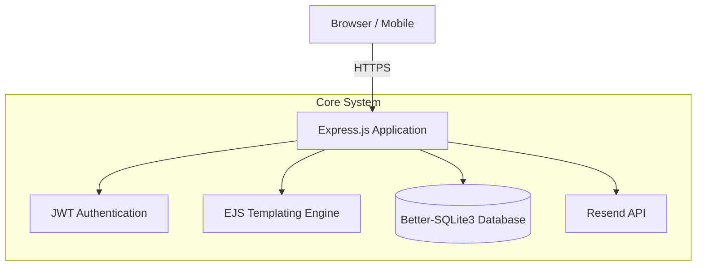
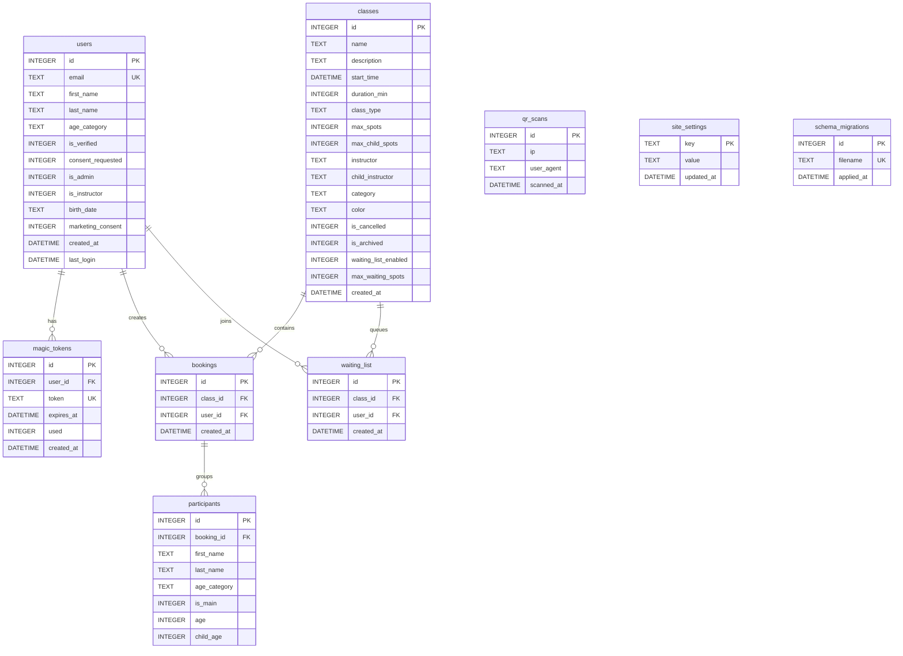

<div align="center">
  <h1>🧗Fantastyczne Wspinanie</h1>
  <p><strong>Climbing Class Registration & Management System</strong></p>

  [](https://github.com/prod-explore/climbing-booking/actions)
  [](https://nodejs.org/)
  [](https://www.sqlite.org/)
</div>

## 📌 Overview

**Fantastyczne Wspinanie** is a secure, lightweight, and fast web application designed to manage complex registrations and attendance for climbing classes. Built as part of a structured program, it provides instructors with powerful tools to manage participant lists while offering a seamless registration experience for students and parents.

Unlike generic CMS solutions, this platform focuses heavily on **business logic tailored for sports facilities**: a dynamic class schedule, complex instructor-level permissions, and granular participant tracking.

---

## 🏗️ Architecture

The system is a monolith Node.js application built with Express, utilizing a local SQLite database for high-performance, low-overhead data management.



---

## 🧠 Key Decisions

- **Why SQLite over PostgreSQL/MySQL?**: The system is designed as a single-tenant deployment for one climbing facility. Using `better-sqlite3` provides ultra-fast, synchronous data access without network overhead (TCP/IP). With WAL (Write-Ahead Logging) mode enabled, it easily handles the required read/write concurrency while eliminating the need to manage and maintain a separate database server.
- **Why Server-Side Rendering (EJS) over a SPA?**: The application consists primarily of complex registration forms, attendance lists, and schedules. SSR significantly reduced time-to-market for a solo developer by removing the overhead of building and maintaining a separate REST API and frontend state management. Furthermore, SSR ensures an immediate "First Contentful Paint," which is critical for instructors and parents accessing the site on mobile devices within climbing gyms where internet coverage is often poor.
- **Why does the e-mail link only show a button?**: Mail scanners and link previews open the URLs in a message before the person does. If opening the link logged you in (and spent the one-time token), the token could be gone by the time of the real click. `GET /auth/verify` therefore only renders a confirmation page; `POST /auth/verify` checks and spends the token in one transaction and sets the session.
- **Why are the places counted inside the booking transaction?**: The limit of each pool (adults, children) is a rule about the data, so `BookingModel.book` enforces it under `BEGIN IMMEDIATE` and throws `SpotsError`, instead of relying on the route checking first and inserting next. The route's own check only produces a readable message.
- **Why are the operator and venue details in the database?**: Who the data controller is, their tax number and where the classes take place differ per deployment and change over time, so they are not written in the templates. They are rows of `site_settings`, edited in the admin panel (`/admin/settings`, NIP checked with its control digit), and the footer, privacy policy, terms and the map section print them; until they are filled in, the pages show a visible placeholder and the admin dashboard says so. The same reasoning applies to every public address: `og:url`, `og:image` and the canonical link are built from `APP_URL` and the requested path, so a link shared in Messenger or Facebook (they follow `og:url`) always leads to the real site.
- **Schema Evolution (Iterative Development)**: The data model evolved continuously alongside business requirements. Major pivots included implementing Role-Based Access Control (RBAC) to separate admin/instructor views, adding age categories and parental consent workflows for minors, and restructuring the class schedule tables (`max_child_spots`, `child_instructor`) to support a unique "Dual Capacity" system where adult classes run parallel to dedicated children's animations.

---

## ✨ Features

### 👨‍🏫 Instructor & Account Management
- **Role-Based Access Control (RBAC)**: Secure access tailored specifically for Instructors and Administrators via JWT tokens.
- **Granular Instructor Profiles**: Each instructor has a dedicated account with access strictly limited to their assigned classes.
- **Cross-List Permissions**: Advanced logic allows designated instructors (e.g., animation coordinators) to access specialized cross-lists while maintaining the security of primary climbing lists.

### 📅 Class Calendar & Scheduling
- **Dynamic Registration Schedules**: Automated class slots available for sign-ups based on day of the week, instructor availability, and class type (e.g., beginner, advanced, children's animations).
- **Attendance Tracking**: Real-time participant list management allowing instructors to quickly check in students directly from their mobile devices during classes.
- **Capacity Control**: Separate adult and child pools per class, enforced inside the booking transaction, so a group is booked whole or not at all.
- **Waiting List**: When a class is full, adults can queue; the first in line is booked and notified by e-mail as soon as a place frees up.
- **Admin Settings**: The data controller, NIP and the venue's address are edited in the admin panel, not in the code; link previews use the configured `APP_URL`.

### 🔒 Security & Operations
- **Automated Email Notifications**: Integration with the `Resend` API for transactional emails, registration confirmations, and important schedule changes.
- **Security**: One-time magic links (15 minutes, spent on a confirmation click), HttpOnly + SameSite session cookie, a same-origin check on every write, rate limits per IP and per e-mail address, `helmet` headers, input validation (`validator`), and a startup check that refuses a placeholder `JWT_SECRET`. See *Known limitations* for what is not covered.
- **Server-Side Rendering**: Fast, SEO-friendly, and accessible views rendered natively via EJS.
- **Containerized**: Fully Dockerized for instant, reproducible deployments across any environment.

---

## 🗄️ Database Schema (ERD)



---

## 📦 Schema Migrations

The schema evolves through numbered SQL files. To add a change, create a new file — it will be applied automatically on next startup:

```
src/migrations/
├── runner.js                   ← migration runner (tracks history, atomic transactions)
├── 001_init_schema.sql
├── 002_user_verification.sql
├── 003_instructor_role.sql
├── 004_family_classes.sql
├── 005_class_color_archive.sql
├── 006_waiting_list.sql
└── 007_site_settings.sql
```

---

## 🚀 Getting Started

### Prerequisites
- Node.js (v22+)
- Docker & Docker Compose (Optional, for containerized deployment)
- Resend API Key

### Installation (Local)

1. **Clone the repository:**
   ```bash
   git clone https://github.com/prod-explore/climbing-booking.git
   cd climbing-booking
   ```

2. **Configure Environment Variables:**
   Copy the example environment file and fill in the values:
   ```bash
   cp .env.example .env
   ```
   *Set `RESEND_API_KEY`, `APP_URL` (required in production: the links in e-mails are built from it) and `JWT_SECRET` (generate it with `openssl rand -hex 32`; the app refuses to start with a placeholder, a short or a repetitive value, unless `ALLOW_WEAK_SECRETS=true` for local work). Admin and instructor accounts are configuration, not code: list them in `ADMIN_EMAILS` and `INSTRUCTORS` (`address:First name`, comma-separated); the accounts are created on start. The public contact address shown on the site and in e-mails is `CONTACT_EMAIL`. After the first admin login, fill in the operator and venue details under *Ustawienia* (`/admin/settings`): until then the footer, privacy policy and terms show placeholders. The sender of the e-mails is `EMAIL_FROM`, by default `noreply@` on the host of `APP_URL` (Resend only sends from a verified domain).*

3. **Install Dependencies:**
   ```bash
   npm install
   ```

4. **Run the Application:**
   ```bash
   npm start
   ```

### Installation (Docker)

```bash
docker-compose up --build -d
```
The application will be exposed on the port defined in your `docker-compose.yml`.

---

## 🧪 Tests

```bash
npm test
```

The suite uses an in-memory SQLite database and needs no services. It runs against the real models and the real app; only the e-mail sender is replaced:

- **Capacity** (`BookingModel.book`): a refused group leaves nothing behind, the adult and child pools stay apart, duplicates use no places, the waiting list is promoted through the real service.
- **Login tokens**: expiry (including a token that expired a minute ago, the same day), single use.
- **Login flow over HTTP** (supertest, no port opened): the e-mail link does not spend the token, `POST /auth/verify` logs in once, the `next` parameter cannot leave the site, the per-address limit.
- **HTTP**: health check, error pages, redirects of protected pages, security headers, and the same-origin check on state-changing requests.
- **Views**: server data embedded in `<script>` elements stays inert, even with a hostile name.
- **Site settings**: validation (NIP control digit), placeholders for what is not filled in, the admin-only page, and that the public pages print what was saved; `og:url`, `og:image` and the canonical link come from `APP_URL`, never from a literal.
- **Configuration**: the secret and `APP_URL` checks; parsing of `ADMIN_EMAILS` and `INSTRUCTORS`; the contact address (`CONTACT_EMAIL`) on the pages and in the e-mails, with Resend mocked.
- **Migrations**: the runner applies every file once and records it.

---

## 🤖 CI/CD Pipeline

The project uses **GitHub Actions** for continuous integration. Every push and Pull Request to the `main` branch triggers an automated pipeline that:
1. Installs dependencies with `npm ci` (Node 22 and 24).
2. Runs the full test suite (`npm test`) on an isolated in-memory database.
3. Fails on known high-severity vulnerabilities in production dependencies (`npm audit`).
4. Builds the Docker image.

---

## 📂 Technical Stack

- **Backend framework**: Express.js
- **Database**: SQLite (via `better-sqlite3`)
- **Authentication**: JSON Web Tokens (`jsonwebtoken`)
- **Email Delivery**: Resend (`resend`)
- **Templating**: EJS
- **Security**: Helmet (headers and a CSP, see *Known limitations*), Express Rate Limit plus a per-address limit, HttpOnly + SameSite cookies, one-time magic links, same-origin check on writes

---

## ⚠️ Known limitations

- **The CSP allows inline scripts** (`'unsafe-inline'`): the views use inline handlers and script blocks. Moving to nonces means moving those handlers into `public/js/main.js`.
- **A session is a 90-day JWT** that cannot be revoked before it expires; logging out clears the cookie only. Server-side sessions (as in a typical session table) would fix it.
- **Rate limits live in memory**, so they reset on restart, and the app is a single process by design (SQLite, no shared state).
- **Input is sanitised twice**: tags are stripped from every body field (`sanitizeBody`) and EJS escapes on output. The second is the one that protects; the first is a legacy of the early versions.

---
<div align="center">
  <i>Developed for Fantastyczne Wspinanie.</i>
</div>
