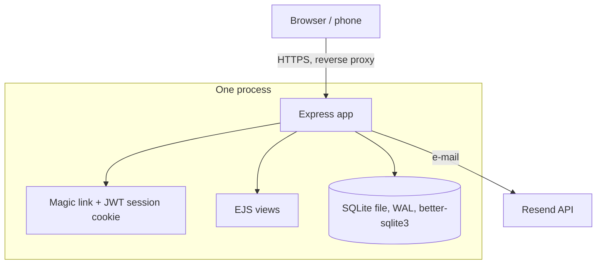
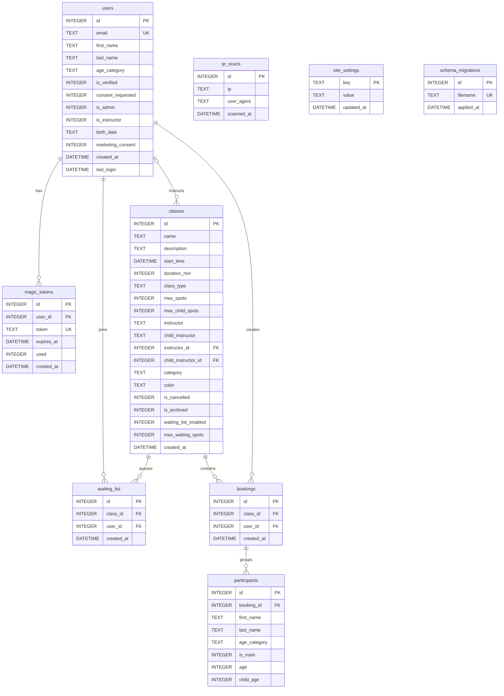

# Fantastyczne Wspinanie: climbing class booking

[](https://github.com/prod-explore/climbing-booking/actions/workflows/ci.yml) 

Registration system for a climbing school, in production for 200+ users. One Express process renders the pages (EJS) and keeps everything in one SQLite file: no SPA, no separate API, no database server. What a generic booking form does not do: separate adult and child places per class, counted inside the booking transaction; a waiting list that books the next person by itself; and login by a one-time e-mail link that mail scanners cannot use up. The interface is in Polish; code and docs are in English.


```bash
git clone https://github.com/prod-explore/climbing-booking.git && cd climbing-booking
npm ci
cp .env.example .env && echo "JWT_SECRET=$(openssl rand -hex 32)" >> .env
npm run seed && npm start    # then open http://localhost:3000/calendar?week=1
```

To log in locally, request a link for `admin@example.com` at <http://localhost:3000/admin/login> (or any address at `/login`): without `RESEND_API_KEY` the e-mail, with its link, is printed in the terminal instead of being sent (only outside production).

---

## Architecture



```
src/
├── app.js            middleware order, error pages, startup
├── routes/           auth, user (calendar, booking), admin, instructor
├── middleware/       session (auth.js), same-origin check, rate limits, helmet/CSP
├── models/           database.js: connection and all queries
├── migrations/       numbered SQL files and their runner
├── services/         e-mail (Resend), waiting list promotion
└── utils/            configuration parsing, site settings, safe redirects, ...
views/                EJS templates (Polish UI)
scripts/seed-demo.js  sample data for a local database
```

---

## Key decisions

- **Why SQLite over PostgreSQL/MySQL?** It is a single-tenant deployment for one climbing school. `better-sqlite3` gives synchronous queries without a network hop, WAL mode lets reads run while a booking writes, and there is no database server to run or back up separately: the whole state is one file on a Docker volume.
- **Why server-side rendering (EJS) over a SPA?** The application is mostly forms, lists and a weekly calendar. Rendering on the server removed a separate REST API and client-side state for a solo developer, and the first paint does not wait for a JavaScript bundle, which matters on phones in a climbing hall with poor coverage.
- **Why does the e-mail link only show a button?** Mail scanners and link previews open the URLs in a message before the person does. If opening the link logged you in (and spent the one-time token), the token could be gone by the time of the real click. `GET /auth/verify` therefore only renders a confirmation page; `POST /auth/verify` checks and spends the token in one transaction and sets the session. The token is also kept out of the access log.
- **Why are the places counted inside the booking transaction?** The limit of each pool (adults, children) is a rule about the data, so `BookingModel.book` enforces it under `BEGIN IMMEDIATE` and throws `SpotsError`, instead of relying on the route checking first and inserting next. The route's own check only produces a readable message.
- **Why are the operator and venue details in the database?** Who the data controller is, their tax number (NIP), where the classes take place and who funds them differ per deployment and change over time, so they are not written in the templates. They are rows of `site_settings`, edited in the admin panel (`/admin/settings`, NIP checked with its control digit); the footer, privacy policy, terms and the map print them, and until they are filled in the pages show a visible placeholder and the admin dashboard says so. An optional funding note (for example an EU co-funding notice) is shown on the home and login pages, in the footer and in the e-mails only when it is set. Likewise `og:url`, `og:image` and the canonical link are built from `APP_URL`, so a link shared on Messenger or Facebook leads to the real site.
- **How did the schema evolve?** Through numbered migrations, following the school's needs: user verification and parental consent for 16–17-year-olds, an instructor role, classes with a separate children's pool and children's instructor, colours and an archive, the waiting list, the site settings, and finally foreign keys from classes to instructor accounts. Until migration 008 a class named its instructor in free text and the panel matched it against first names, so "Jan" also saw "Janina"'s classes; the migration links existing classes only where the name matches exactly one account and leaves the rest for an administrator to pick.

---

## Features

**Participants**
- Weekly calendar of upcoming classes; booking yourself plus up to four more people, with each person's age deciding the pool (adult from 16, child below).
- Separate adult and child places per class, enforced in the booking transaction: a group is booked whole or not at all, and a child is booked only together with an adult.
- Waiting list for full classes (adults, up to 15 per class): when a place frees up, the first person is booked and told by e-mail.
- Cancelling a booking or a single participant up to two hours before the class.
- Accounts for 16- and 17-year-olds wait for an administrator's approval before they can book.

**Instructors**
- Accounts come from configuration (`INSTRUCTORS`), not from the database or the code.
- A class points at instructor accounts (main and children's instructor, picked from a list in the class form); an instructor sees only the classes linked to their account and their participant lists, which can be copied as text or printed.

**Administrators**
- Creating, editing, cancelling and archiving classes; copying the current week's classes one or more weeks ahead; past weeks are archived automatically.
- Participant lists with removal (the person who booked gets an e-mail) and the waiting list; approval of minors' accounts.
- Operator and venue details and an optional funding note (`/admin/settings`); a count of visits from the QR code on printed leaflets (`/qr`).

**E-mail** (Resend): the login link, a notice when the admin removes a participant, and a notice when the waiting list books you.

**Security**: one-time login links (15 minutes, spent on a confirmation click, at most three per address per hour), an HttpOnly + SameSite=Lax session cookie (Secure in production) signed with HS256 only, a same-origin check on every state-changing request, rate limits per IP, `helmet` headers and CSP, escaped output in the views, and a startup check that refuses a placeholder `JWT_SECRET`. See *Known limitations* for what is not covered.

---

## Database schema (ERD)



`bookings` and `waiting_list` are also unique per `(class_id, user_id)`: one booking and one waiting-list place per person and class. `classes.instructor_id` and `child_instructor_id` both reference `users`; the `instructor` and `child_instructor` text columns keep the display name.

---

## Schema migrations

The schema changes through numbered SQL files. A new file is applied on the next start, once, in its own transaction, and recorded in `schema_migrations`:

```
src/migrations/
├── runner.js
├── 001_init_schema.sql
├── 002_user_verification.sql
├── 003_instructor_role.sql
├── 004_family_classes.sql
├── 005_class_color_archive.sql
├── 006_waiting_list.sql
├── 007_site_settings.sql
└── 008_class_instructor_ids.sql
```

---

## Running it

### Locally

The quick start at the top runs it in development mode (Node.js 22 or newer). Configuration lives in `.env`; `.env.example` lists and explains every variable. The ones that matter:

- `JWT_SECRET`: signs the session cookie. Generate it with `openssl rand -hex 32`; the app refuses to start with a placeholder, a short or a repetitive value (unless `ALLOW_WEAK_SECRETS=true`, for local work).
- `APP_URL`: the public address; links in e-mails and link previews are built from it. Required in production.
- `ADMIN_EMAILS` and `INSTRUCTORS` (`address:First name`, comma-separated): the accounts are created on start.
- `RESEND_API_KEY` and `EMAIL_FROM`: required in production. The sender defaults to `noreply@` on the host of `APP_URL`, and Resend only sends from a verified domain.
- `CONTACT_EMAIL`: the public contact address on the pages and in the e-mails.

After the first admin login, fill in the operator and venue details under *Ustawienia* (`/admin/settings`).

### With Docker

```bash
cp .env.example .env    # set JWT_SECRET, APP_URL, ADMIN_EMAILS, RESEND_API_KEY
docker compose up --build -d
```

The container `climbing-booking-app` runs in production mode as the unprivileged `node` user, keeps the database on the volume `climbing_booking_data`, has a health check on `/healthz`, and is published on `127.0.0.1:3000` only (`HOST_PORT` changes the port). Put a TLS-terminating reverse proxy in front of it, or attach the proxy to the `climbing-booking-network` network.

---

## Tests and checks

```bash
npm test       # jest
npm run lint   # ESLint
```

There are more than 140 tests in 16 files (jest reported 141 when this README was last updated; the figure here is rounded down to the ten). The suite uses an in-memory SQLite database and needs no services. It runs against the real models and the real app (supertest, no port opened); only the e-mail sender is replaced where a test would send mail:

- **Capacity** (`BookingModel.book`): a refused group leaves nothing behind, the adult and child pools stay apart, duplicates use no places, the waiting list is promoted through the real service.
- **Login tokens**: expiry (including a token that expired a minute ago, the same day), single use.
- **Login flow over HTTP**: the e-mail link does not spend the token, `POST /auth/verify` logs in once, the `next` parameter cannot leave the site, the per-address limit, the session cookie flags and the signing algorithm.
- **HTTP**: health check, error pages, redirects of protected pages, security headers (including the referrer policy the same-origin check depends on), and the same-origin check on state-changing requests.
- **Admin**: a rejected class form is shown again with what was typed, a long description is kept, instructors are picked from their accounts (an unknown id is refused, an old unlinked name can be kept), the admin login does not reveal which addresses are admins.
- **Instructor access**: "Jan" sees neither "Janina"'s classes nor her participants' e-mail addresses; migration 008 links only unambiguous names.
- **Views**: server data embedded in `<script>` elements stays inert, no view uses inline event handlers (the CSP blocks them), the calendar modals put names in as text.
- **Site settings**: validation (NIP control digit), placeholders for what is not filled in, the admin-only page, and that the public pages print what was saved; `og:url`, `og:image` and the canonical link come from `APP_URL`.
- **Configuration and e-mail**: the secret and `APP_URL` checks; parsing of `ADMIN_EMAILS` and `INSTRUCTORS`; the contact address on the pages and in the e-mails (Resend mocked); printing instead of sending outside production; the access log hides login tokens.
- **Migrations and demo data**: the runner applies every file once and records it; the seed script fills only an empty database.

## CI

GitHub Actions (`.github/workflows/ci.yml`) runs on every push and pull request to `main`:

1. on Node 22 and 24: `npm ci`, `npm run lint`, `npm test`, and `npm audit --omit=dev --audit-level=high`;
2. builds the Docker image, starts it and waits for `/healthz` to answer.

Dependabot proposes weekly updates for npm packages, the Docker base image and the Actions used.

---

## Technical stack

- **Runtime and framework**: Node.js 22+, Express 4
- **Database**: SQLite through `better-sqlite3`, WAL mode
- **Views**: EJS, plain CSS and JavaScript
- **Authentication**: one-time links, JWT session cookie (`jsonwebtoken`)
- **E-mail**: Resend
- **Security**: `helmet` (headers and CSP), `express-rate-limit` plus a per-address limit, `validator`
- **Tests**: Jest, supertest; **lint**: ESLint

---

## Known limitations

- **The CSP allows inline `<script>` blocks** (`'unsafe-inline'` in `script-src`): the views keep their page scripts inline. Inline event handler attributes are already blocked (`script-src-attr 'none'`, and a test keeps them out); moving the script blocks to files under `public/js/` would allow dropping `'unsafe-inline'`.
- **A session is a 90-day JWT** that cannot be revoked before it expires; logging out clears the cookie only. Server-side sessions (a session table) would fix it.
- **Rate limits live in memory**, so they reset on restart, and the app is a single process by design (SQLite, no shared state).
- **Input is sanitised twice**: tags are stripped from every body field (`sanitizeBody`) and EJS escapes on output. The second is the one that protects; the first is a legacy of the early versions.
